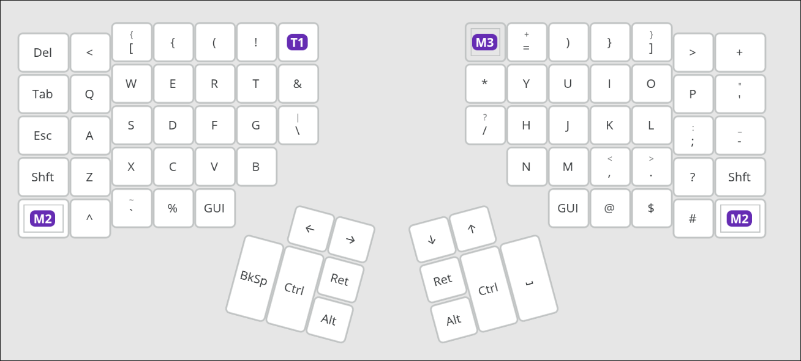

# Dotfiles

For terminal-first development, run `fwdev` from `~/.local/bin` (Stow package
`dev`). It prepares new/existing projects and reviewed direnv environments while
leaving builds, target selection, flashing and debugging explicit. See the
[Neovim development handbook](nvim/.config/nvim/README.md) for setup, workflows,
keymaps and tool configuration.

## Keyboard Layout (Kinesis Advantage 360)



---

## Dotfiles organization

The directories and files are organized to be managed with **GNU Stow**:

```bash
├── alacritty
├── emacs
├── fastfetch
├── hypr
├── .tmux.conf
├── waybar
└── .zshrc
```

To apply the configurations on a Unix-like system that follows the **Filesystem Hierarchy Standard**,
make sure **stow** is installed:

```bash
# e.g., installation on Arch Linux
sudo pacman -S stow

# Clone the repository and apply the desired configuration(s)
git clone https://github.com/gnix0/dotfiles.git

cd ~/path/to/local/repo

stow <app_dir_name>
```

> [!NOTE]
> These configurations are tailored to my own system and workflow. Feel free to use them as reference or
> inspiration, but do not expect them to work out of the box on your machine. Building your own configuration
> is one of the best ways to learn the tools you use and create an environment that fits your own workflow.
